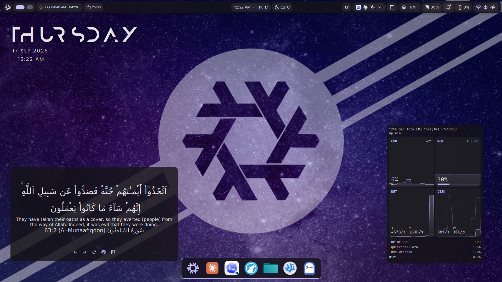
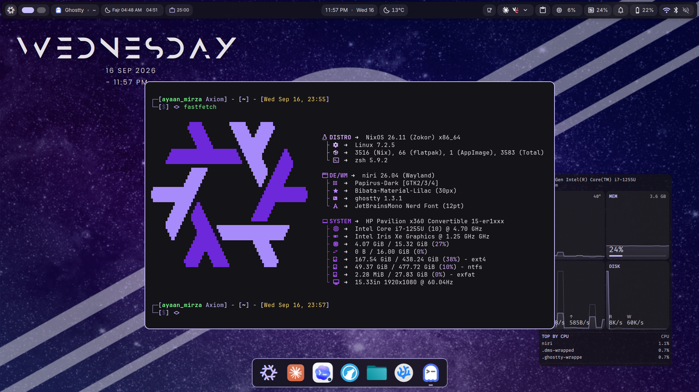

<h2 align="center">:snowflake: ☭ Комиссар Блятников's Nix Config ☭ :snowflake:</h2>

<p align="center">
  
</p>

<p align="center">
    <a href="https://nixos.org/">
        </a>
    <a href="https://github.com/nixos/flakes">
        </a>
</p>

> My configuration is becoming more and more complex, but it should be readable for beginners as it is clearly organized into modules and contains comments for guidance.

This repository is home to the nix code that builds my system:

- **NixOS Desktop (Axiom)** — my main daily driver. Daily session is **niri** (scrollable-tiling Wayland compositor) shelled by **DankMaterialShell (DMS)**, with **COSMIC** kept installed as an alt session at the greeter. Lanzaboote-signed boot, PipeWire audio, Waydroid, and extensive customization.

See [`/.config/refind`](./.config/refind/) for my rEFInd configuration, and [`/.config/niri`](./.config/niri/) for my niri + DMS config. Historical Niri configs are kept in [`/.config/niri/backups`](./.config/niri/backups/).

See [`/modules/`](./modules/) for each configuration module, and [`/modules/home-manager/`](./modules/home-manager/) for user-specific config files configured as modules within home-manager.
 
## Hardware

**Axiom** — HP Pavilion x360
- **CPU:** Intel Core i7-1255U
- **GPU:** Intel Iris Xe (integrated)
- **RAM:** 16GB

## Structure

```
.
├── .config/
│   ├── .img/                       # README screenshots and images
│   ├── .vscode/
│   │   └── argv.json               # VS Code launch arguments
│   ├── cosmic/
│   │   └── My Personal Colour Prefs.ron   # COSMIC personal color preferences
│   ├── fastfetch/
│   │   ├── compact-config.jsonc    # daily fastfetch config
│   │   ├── config.jsonc            # full fastfetch config
│   │   └── logo.txt                # custom logo
│   ├── misc/
│   │   ├── icons/                  # custom icons (web app launchers)
│   │   ├── MYNT Backup.json        # app settings backup
│   │   └── natsumi-theme.json      # Natsumi browser theme settings
│   ├── niri/
│   │   ├── backups/                # historical niri configs
│   │   ├── dms/                    # DMS-managed niri settings
│   │   │   ├── alttab.kdl
│   │   │   ├── binds.kdl
│   │   │   ├── colors.kdl
│   │   │   ├── cursor.kdl
│   │   │   ├── input.kdl
│   │   │   ├── layout.kdl
│   │   │   ├── outputs.kdl
│   │   │   ├── windowrules.kdl
│   │   │   └── wpblur.kdl
│   │   └── config.kdl              # niri main config, symlinked via Home Manager
│   ├── refind/
│   │   ├── refind.conf             # rEFInd configuration
│   │   └── refind.conf-sample      # upstream sample for reference
│   ├── VSCodium/
│   │   ├── extension.json          # VSCodium extensions
│   │   └── settings.json           # VSCodium settings
│   └── wallpapers/                 # desktop wallpapers
├── modules/
│   ├── home-manager/
│   │   ├── dotfiles/
│   │   │   ├── fastfetch.nix       # links .config/fastfetch into the HM profile
│   │   │   ├── nixcord.nix         # Discord client (nixcord) settings
│   │   │   ├── nixd.nix            # nixd LSP settings, points at this flake's option tree
│   │   │   ├── superfile.nix       # superfile file manager + zoxide
│   │   │   ├── vscode.nix          # VS Code settings and extensions
│   │   │   ├── web-apps.nix        # web app desktop entries
│   │   │   └── zsh.nix             # Oh-My-Zsh, PATH exports, flatpak() sync wrapper
│   │   ├── gtk.hm.nix              # GTK theming (Catppuccin, gtk.css, dconf)
│   │   ├── niri.config.nix         # niri config symlink + DMS activation fixes
│   │   ├── programs.hm.nix         # user-level home.packages and DankSearch
│   │   ├── services.hm.nix         # user services (udiskie, flatpak updates, icon cache)
│   │   └── stylix.hm.nix           # HM-side Stylix (cursor, fonts, theming targets)
│   ├── desktop.nix                 # display manager, COSMIC, audio, fonts, keymap, Bibata cursor
│   ├── flatpak.nix                 # declarative Flatpak packages (Flathub only)
│   ├── gtk.nix                     # Catppuccin GTK theme package, shared by both Stylix modules
│   ├── home-manager.nix            # wires up Home Manager and its modules
│   ├── niri.nix                    # niri compositor + DankMaterialShell, portals, xwayland-satellite
│   ├── programs.nix                # system packages grouped by purpose, plus program options
│   ├── services.nix                # accounts, Flatpak overrides, doas/sudo, printing
│   ├── stylix.nix                  # system-wide Stylix theming (fonts, cursor, base16 scheme)
│   └── system.nix                  # Lanzaboote, Plymouth, networking, Waydroid, swap, mounts
├── configuration.nix               # entry point — imports every module
├── flake.nix / flake.lock
├── hardware-configuration.nix
└── README.md
```

## Components

### Desktop Environment & Shell
| | |
|---|---|
| **Bootloader** | systemd-boot with Lanzaboote (signed UKIs) for Secure Boot, chainloaded from rEFInd (Catppuccin Macchiato theme) |
| **Boot Theme** | Plymouth (mac-style) |
| **Display Manager** | greetd + dank-greeter (DMS-themed login screen, niri compositor) |
| **Desktop Environments** | niri (primary — scrollable-tiling Wayland) shelled by DankMaterialShell; COSMIC kept as an alt session at the greeter |
| **Window Managers** | niri (native), COSMIC native WM (alt session) |
| **Terminal Emulator** | Ghostty |
| **Shell** | Zsh + Oh-My-Zsh (xiong-chiamiov-plus theme; plugins: git, npm, history, node, rust, deno), autosuggestions, syntax highlighting, zoxide |
| **Notification Daemon** | DankMaterialShell (niri session), COSMIC native services (alt session) |
| **Network Management** | NetworkManager |
| **Theme** | Catppuccin Mocha + Mauve system-wide; Catppuccin-Mauve-Dark for GTK, qt5ct/qt6ct + Kvantum (rounded) for Qt; Stylix handles fonts, cursor, and the base16 scheme |
| **Cursor** | Bibata Material (Lilac)|
| **Web Browser** | LibreWolf, Helium, and Firefox |

### Apps & Tools
| |                                                        |
|---|--------------------------------------------------------|
| **System Monitor** | Mission Center (Flatpak, primary), GNOME System Monitor, Fastfetch (terminal), DMS system monitor widget |
| **File Manager** | Superfile, Dolphin, and Yazi; COSMIC Files in the COSMIC session |
| **Media Player** | VLC, Spotify (Flatpak) |
| **Editors / IDE** | Visual Studio Code (primary, managed declaratively through Home Manager), VSCodium, Zed, Kate; Neovim is the default `$EDITOR` |
| **Fonts** | Noto fonts, Noto Color Emoji, JetBrains Mono Nerd Font installed system-wide; Stylix themes GTK/QT apps in DejaVu Sans / DejaVu Sans Mono |
| **Icon Theme** | Papirus-Dark, forced system-wide via Stylix (GTK + dconf) and applied to Flatpak apps via override |
| **Image Viewer** | GNOME Image Viewer / Loupe (Flatpak) |
| **Mail** | Thunderbird ESR (Flatpak) |
| **Chat** | Vesktop (via nixcord, Material Discord theme), Telegram, Teams for Linux, Ferdium |
| **Productivity** | Obsidian, OnlyOffice, DankCalendar |
| **Password Manager** | Proton Pass, GNOME Keyring |
| **Screenshots** | grim + slurp + Satty |
| **Screen Recording** | Kooha (Flatpak) |
| **Download Manager** | Free Download Manager |
| **ISO Flashing** | KDE ISO Image Writer, Impression (Flatpak), Ventoy |
| **Disk & Partition Management** | GNOME Disks, KDE Partition Manager |
| **App Store / Sideloading** | Bazaar, Gear Lever, Warehouse, Flatseal (Flatpak) |
| **Gaming** | Steam, GameMode, Chiaki-NG, Hydra Launcher, SKLauncher, Modrinth, Sober, Bottles, ProtonPlus |
| **Containers & Compatibility** | Podman, Docker, Distrobox, cpak, WinPodX (Windows apps as desktop entries), Waydroid |
| **Development Tools** | Git, GitHub CLI, Python3 (pip, virtualenv), Node.js, GDB, Just, Sass, Flutter, nixd + nixfmt, direnv |

### System-Level
| | |
|---|---|
| **Filesystem & Encryption** | Ext4 on LUKS with TPM2 auto-unlock (dual-boot system) |
| **Secure Boot** | Lanzaboote (signed UKIs) + sbctl, with auto-generate and auto-enroll of keys |
| **Kernel** | Latest mainline from nixpkgs, with hibernation to a swapfile |
| **Privilege Escalation** | doas (sudo also enabled, aliased to doas) |
| **Package Formats** | Nix, Flatpak, AppImage |
 
Wallpapers: [`/.config/wallpapers`](./.config/wallpapers/)

## Screenshots

| Desktop | Fastfetch |
|---|---|
|  |  |

## System Modules

### flake.nix
Entry point — defines inputs (nixpkgs unstable, Home Manager, Stylix, Catppuccin, Lanzaboote, DankMaterialShell, nix-flatpak, and the flake-packaged apps), the `Axiom` nixosConfiguration output, and the package overlays (stable Lix for nixpkgs-review/nix-eval-jobs/colmena, rounded Kvantum theme, Chiaki-NG fix).

### configuration.nix
Imports every module, sets Lix as the Nix implementation, enables flakes, and sets the timezone, locale, and state version.

### system.nix
Low-level system configuration: Lanzaboote (signed UKIs), Plymouth boot theme, latest kernel, hibernation and swap, networking (NetworkManager, firewall rules), Waydroid, exFAT/NTFS mount points, session environment variables, and shell aliases (`nix-rebuild`, `nix-clean`, etc.).

### desktop.nix
Graphical environment: dank-greeter (greetd) as the display manager with niri as the default session, COSMIC kept installed as an alt session, PipeWire audio, GNOME Keyring, desktop portals, keymap, font packages, and the custom Bibata Material cursor package.

### niri.nix
niri compositor + DankMaterialShell (panel, dock, launcher, lock screen, notifications), xwayland-satellite from nixpkgs, forced dark color-scheme, and per-session portal routing (COSMIC portal first, wlr fallback for screenshots/screencast).

### stylix.nix
System-wide theming: Catppuccin (Mocha + Mauve) for most targets, Stylix for cursor, fonts, and the base16 colour scheme. Uses [`gtk.nix`](./modules/gtk.nix) to build the Catppuccin GTK theme.

### gtk.nix
Builds the pinned Catppuccin GTK theme package, including the GTK2 murrine engine that nixpkgs dropped. Shared by both the system and Home Manager Stylix modules.

### programs.nix
Every installed application, grouped by purpose (browsers, development, communication, gaming, desktop, hardware, flake-packaged apps), plus program options: Steam, GameMode, nh, direnv, KDE Connect, nix-ld, AppImage, Natsumi/LibreWolf, Neovim, Podman, Docker, and cpak.

### flatpak.nix
Declarative Flatpak package list (Flathub only). Unmanaged Flatpaks get removed on rebuild, so add new apps here.

### services.nix
System services: user account setup, Flatpak daemon (with global dark-mode + Papirus-Dark overrides), doas + sudo, AppArmor, udisks2, USBMUXD, printing/scanning (hplip/sane), and Avahi discovery.

### home-manager.nix
User-level configuration managed through Home Manager. Keeps dotfiles and program configs organized into separate modules: GTK and Stylix theming, the niri config symlink, user services, and per-app files such as zsh, VSCode, nixcord, superfile, and fastfetch. (See [`/modules/home-manager`](./modules/home-manager/))

## Why This Setup?

- **It should just work** — zero time spent debugging basic functionality
- **Keep it recreational** — if configuring something takes more effort than it's worth, I use defaults
- **Version control everything** — if it's not in git, it might as well not exist
- **Organization** — rather than directly declaring everything, they are loaded as modules (See [`/modules/`](./modules/))
- **Prefer flakes** — trivial dependency management and reproducibility

## What You Won't Find Here

- Instructions for others to install this (highly personalized to my hardware/preferences)
- Explanations of basic NixOS concepts (assumes familiarity with NixOS/Flakes)
- Attempts to make this "universal" or "generic" — this is my personal setup
- Apologies for unfree packages (I need some proprietary stuff for my workflow)
- Over-engineering — I optimize for actual usage, not hypothetical edge cases

This configuration evolves as my needs and interests change — check `git log` for what's current.
